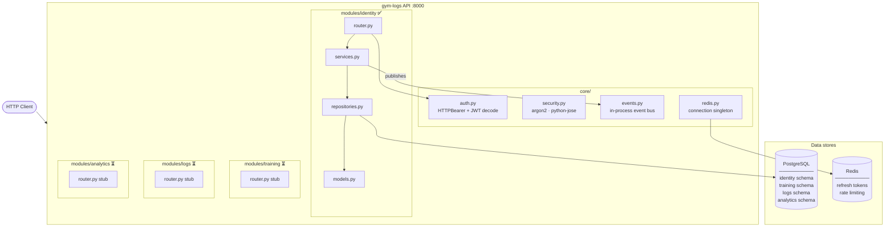
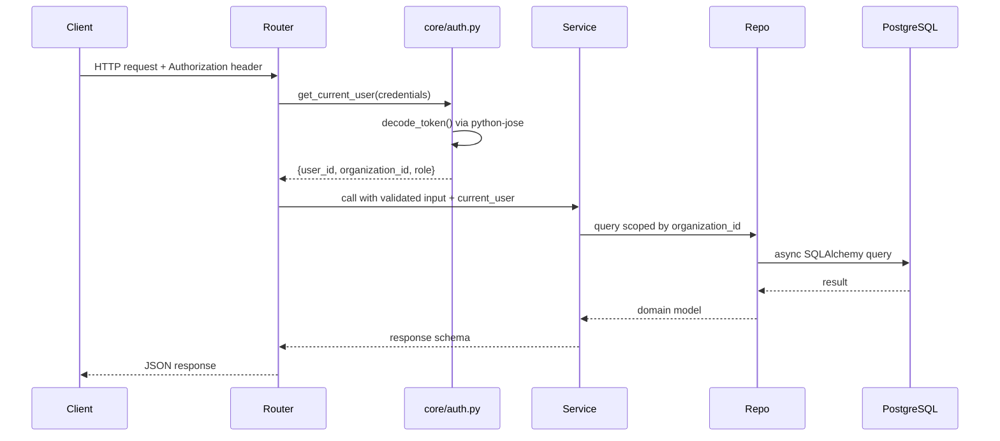
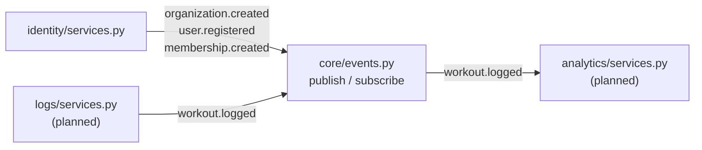

# Architecture

## Approach: Modular Monolith → Microservices

The project starts as a single deployable unit but enforces hard module boundaries from
day one so each module can be extracted into its own microservice with minimal rework.

### Decomposability rules
| Rule | Now (monolith) | Later (microservice) |
|---|---|---|
| Module cross-calls | Through `services.py` interfaces only | HTTP API calls |
| Data isolation | Dedicated PostgreSQL schema per module | Dedicated database per service |
| Async integration | `core/events.py` in-process bus | Replace with aio-pika (AMQP) |

---

## Component diagram



---

## Module responsibilities

### identity ✅
Owns all authentication and authorization primitives.
- Organizations (tenants), users, memberships.
- JWT issuance and refresh-token lifecycle.
- Source of truth for identity — other modules never store credentials.

### training ⏳
Exercise catalog, training programs, program assignments.
- Exercises are per-organization (no global catalog).
- Only trainers/gym_admins create programs and assignments.

### logs ⏳
Workout logs per athlete per session.
- Sets, reps, weight, RPE recorded.
- Publishes `workout.logged` event consumed by analytics.

### analytics ⏳
Read-optimized progression metrics.
- Built purely from events emitted by logs.
- Never writes back to logs.

---

## Data store layout

### PostgreSQL — one DB, four schemas

```
gymlogs database
├── identity schema    ← Organization, User, Membership
├── training schema    ← Exercise, Program, Session, Assignment  (planned)
├── logs schema        ← WorkoutLog, SetLog                      (planned)
└── analytics schema   ← ExerciseProgression                     (planned)
```

When a module is extracted: `CREATE DATABASE gymlogs_<name>` + migrate that schema into it.
The application code only changes the `DATABASE_URL` env var for that service.

### Redis

```
refresh:{token}  →  user_id   TTL: 7 days    (refresh token store)
```

---

## Request lifecycle



---

## Internal event bus

`core/events.py` is a thin in-process pub/sub that matches the future AMQP contract.



**Swap path to AMQP:** replace `publish()` with `aio-pika.publish()` and `subscribe()` with
an AMQP consumer registration. Payload schemas are never changed — they are the contract.
