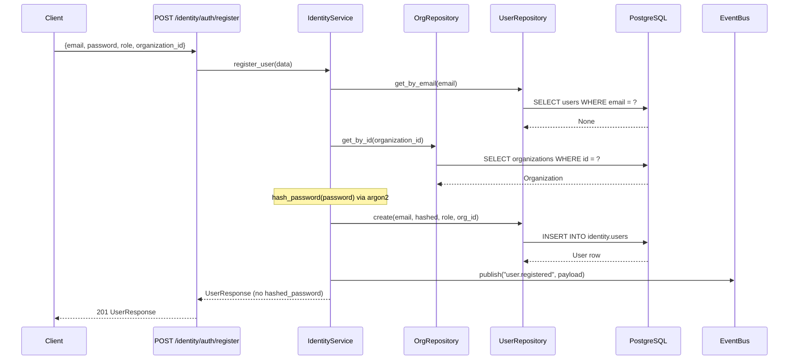
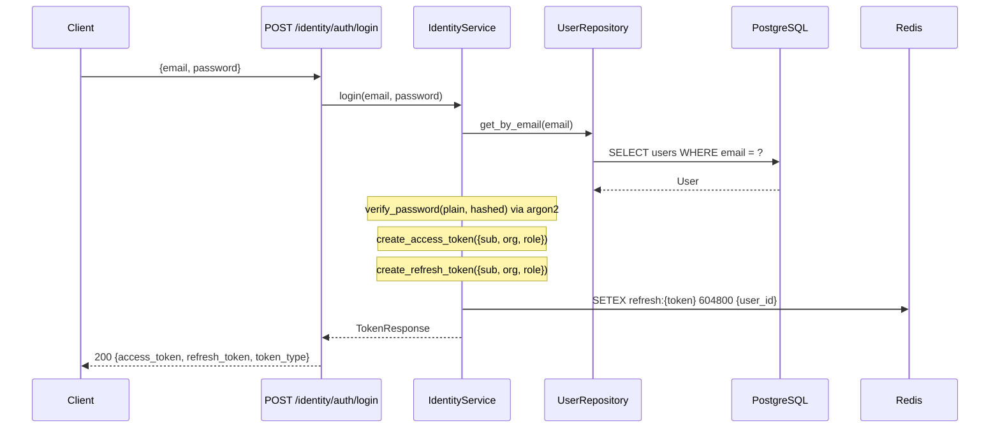
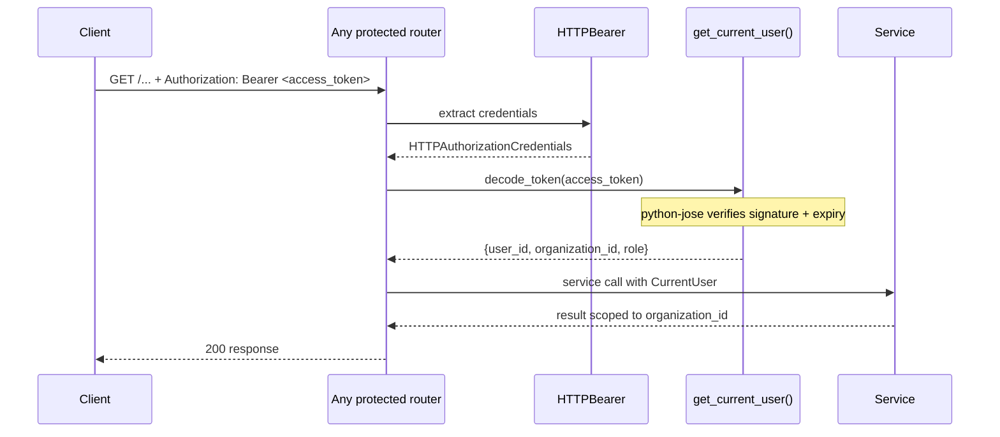
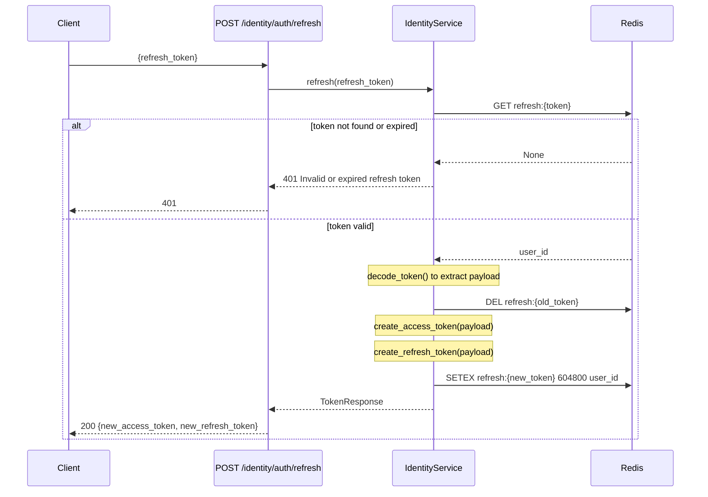
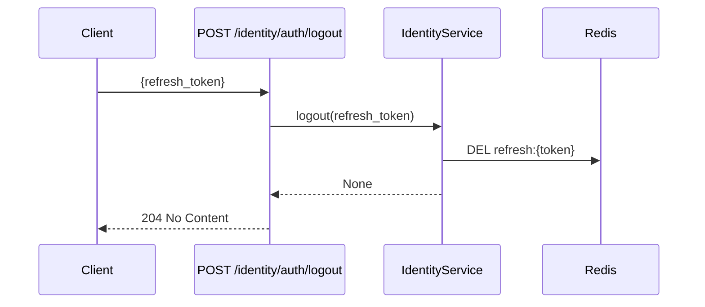

# Authentication & JWT

## Design choices

> **We do NOT use FastAPI's built-in `OAuth2PasswordBearer` or form-based auth.**

| Aspect | FastAPI default | Our implementation |
|---|---|---|
| Token extraction | `OAuth2PasswordBearer` (form data, `/token` endpoint) | `HTTPBearer` — reads `Authorization: Bearer <token>` header |
| Login body | `application/x-www-form-urlencoded` `{username, password}` | `application/json` `{email, password}` |
| JWT library | none built-in | `python-jose[cryptography]` |
| Password hashing | none built-in | `argon2-cffi` (argon2id) |
| Refresh tokens | not provided | Redis-backed, rotated on every use |

### Why HTTPBearer over OAuth2PasswordBearer

`OAuth2PasswordBearer` couples the API to the OAuth2 form-post flow, adds an unnecessary
`tokenUrl` field to OpenAPI, and returns a `WWW-Authenticate` header that implies an
OAuth2 server. We are building a custom auth system, not an OAuth2 server. `HTTPBearer`
accepts the same `Authorization: Bearer <token>` header without that baggage.

Note: `HTTPBearer` returns **403** (not 401) when no `Authorization` header is present —
this is FastAPI's default for missing scheme credentials. A 401 is raised by our code
when the token is present but invalid or expired.

---

## Token structure

### Access token (JWT, HS256)

```json
{
  "sub": "<user_id>",
  "org": "<organization_id>",
  "role": "athlete | trainer | gym_admin",
  "exp": <unix_timestamp>
}
```

- Signed with `SECRET_KEY` using HS256 via `python-jose`.
- Default TTL: **30 minutes** (`ACCESS_TOKEN_EXPIRE_MINUTES`).
- Stateless — not stored anywhere. Validated on every request by decoding the signature.

### Refresh token (JWT, HS256, Redis-backed)

- Same payload as access token.
- Default TTL: **7 days** (`REFRESH_TOKEN_EXPIRE_DAYS`).
- Stored in Redis as `refresh:{token} → user_id` with matching TTL.
- **Rotated on every use** — old token is deleted, new pair is issued.
- Revocable at any time by deleting the Redis key (logout).

---

## Registration flow



---

## Login flow



**On failure:** wrong email or wrong password both return **401** with a generic
`"Invalid credentials"` message — no distinction to prevent user enumeration.

---

## Authenticated request flow



**No token:** HTTPBearer returns **403** before `get_current_user` is invoked.  
**Invalid/expired token:** `get_current_user` raises **401**.

---

## Token refresh flow



---

## Logout flow



After logout the access token remains valid until it expires naturally (stateless JWT).
If immediate access token revocation is needed in the future, add a Redis denylist keyed
by `jti` claim.

---

## Security file map

| File | Responsibility |
|---|---|
| [core/security.py](../app/core/security.py) | `hash_password`, `verify_password`, `create_access_token`, `create_refresh_token`, `decode_token` |
| [core/auth.py](../app/core/auth.py) | `get_current_user` dependency, `CurrentUser` type alias |
| [core/redis.py](../app/core/redis.py) | Redis connection singleton used for refresh token storage |
| [modules/identity/services.py](../app/modules/identity/services.py) | `login`, `refresh`, `logout` — all token lifecycle logic |
