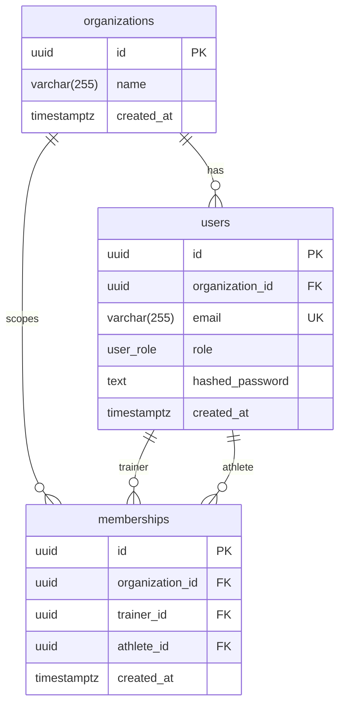
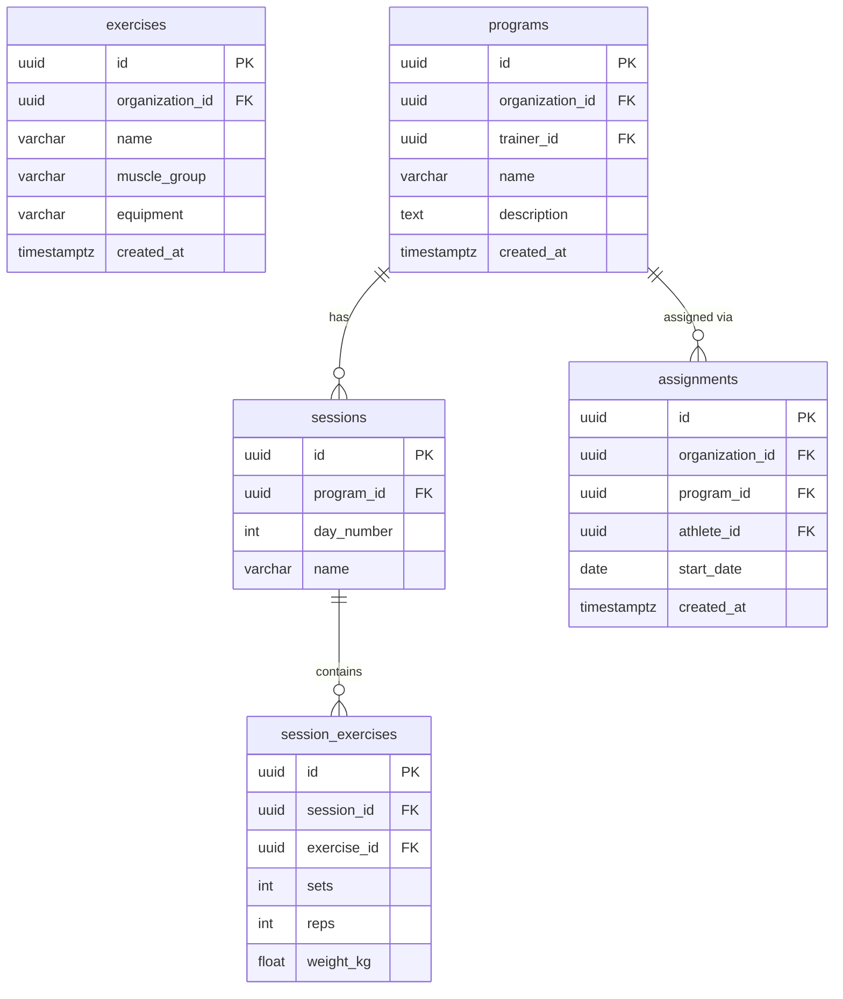
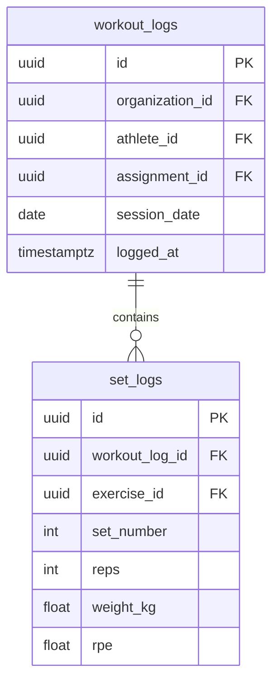
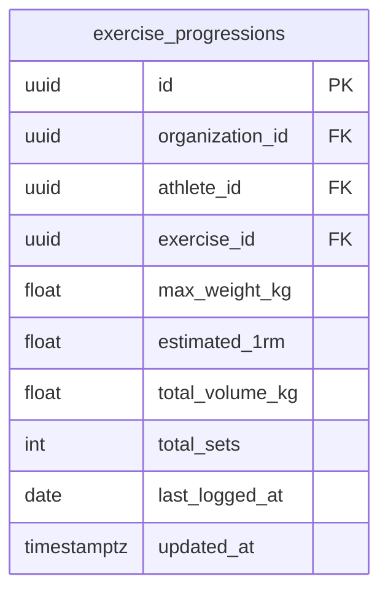

# Data Model

All tables live in a single PostgreSQL database (`gymlogs`) with one schema per module.
Each schema can become an independent database when its module is extracted to a microservice.

---

## identity schema ✅



### Types
- `user_role` — PostgreSQL ENUM: `athlete | trainer | gym_admin`

### Constraints
- `users.email` — globally unique index
- `memberships(trainer_id, athlete_id)` — unique constraint `uq_membership`
- Every row scoped by `organization_id` — cross-org data access is impossible by construction

### Indexes
| Table | Index | Columns |
|---|---|---|
| users | `ix_identity_users_email` | email (unique) |
| users | `ix_identity_users_org` | organization_id |
| memberships | `ix_identity_memberships_org` | organization_id |

---

## training schema ⏳ (planned)



---

## logs schema ⏳ (planned)



---

## analytics schema ⏳ (planned)



Built exclusively from `workout.logged` events — never written by any other module.

---

## Schema isolation rule

```
No module may query or write to another module's schema.

identity.* ←→ training.*   ❌  direct join forbidden
identity.* ←→ training.*   ✅  via HTTP service call or event payload
```

This is enforced by convention today and by network boundary when modules are extracted.
